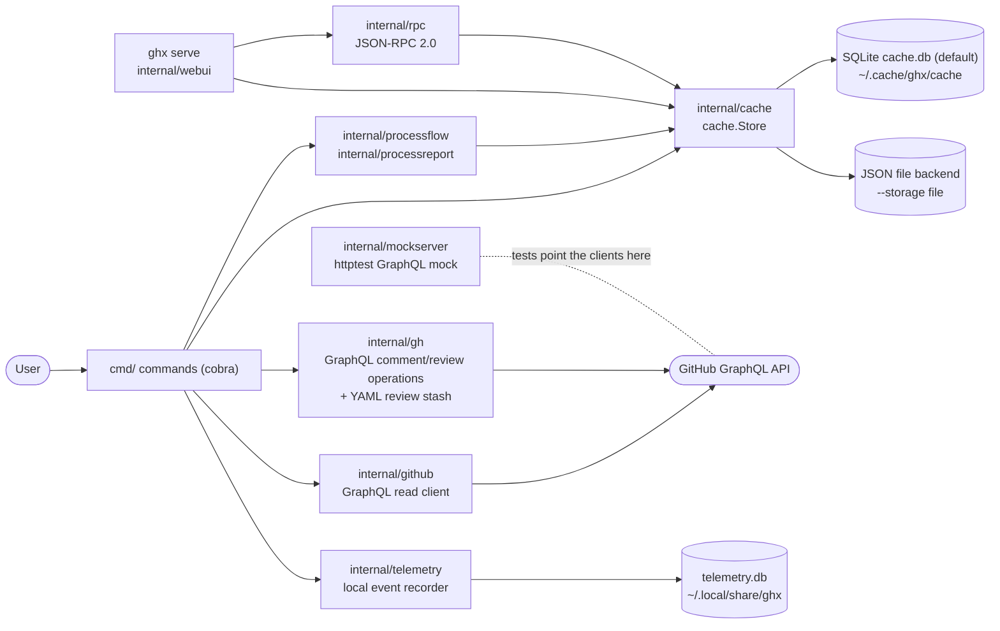
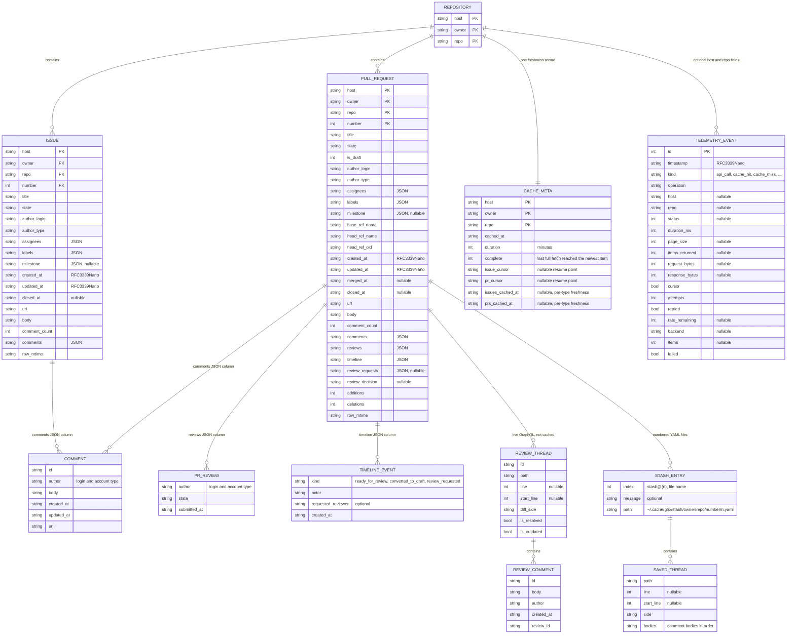

# Architecture

## System Overview

ghx is a single Go binary that extends the GitHub CLI with cache-first reads, comment and review operations, local reports, and local servers.
All GitHub traffic is GraphQL: `internal/github` runs the read queries that fill the cache, and `internal/gh` runs the mutations behind the comment and review commands.
The cache sits behind the `cache.Store` interface with two interchangeable backends: SQLite (`cache.db` under `~/.cache/ghx/cache/`, the default) and per-item JSON files (`--storage file`, env `GHX_STORAGE`).
The web UI (`ghx serve`) and the JSON-RPC 2.0 API (`internal/rpc`) read the same store.
Both servers bind to loopback by default, and any non-loopback bind requires a token.
`internal/telemetry` records local-only timing events in a SQLite database under `~/.local/share/ghx`; it is on by default and never transmits anything.
`internal/mockserver` mirrors the GitHub GraphQL contract in-process, so `ghx mock serve`, the test suite, and the end-to-end CLI tests run without network access.

## Entity Relationship Diagram

The storage entities below come from `internal/cache/schema.sql` (SQLite backend), the per-item JSON layout of the file backend (same record shapes), `internal/github/types.go` (records), `internal/gh/stash.go` (stash), and `internal/telemetry/store.go` (events).

Notes:

- `COMMENT`, `PR_REVIEW`, `TIMELINE_EVENT`, and the nested `assignees`, `labels`, and `milestone` values are stored as JSON text inside their parent row, so every field of `github.Issue` and `github.PullRequest` round-trips losslessly.
- `REVIEW_THREAD` and `REVIEW_COMMENT` (`internal/gh`) are fetched live from the GraphQL API when working with review threads; they are not written to the cache.
- `STASH_ENTRY` and `SAVED_THREAD` are YAML files under `~/.cache/ghx/stash/<owner>/<name>/<number>/`, not database rows.
- The full typed definition of each SQLite table (types, constraints, indexes) lives in `internal/cache/schema.sql`, and the database summary in `.sdlc/context/schema.dbml`.

## Key Components

| Component | Responsibility | Technology |
|---|---|---|
| `cmd/` | CLI layer: root and global flags, `cache` (with `cachehit`, `readcache`, `storage`), `issue` (with `comment`, `comment edit`, `comment delete`), `pr` (with `json`, `comment` + edit/delete, `review`, `review stash`, `threads`, `threads resolve`), `repo`, `stats`, `process`, `mock`, `serve` (with stats and process routes), `rpc`, `remote`, `telemetry`, `logwriter`; also the stats report builder injected into the web UI | cobra |
| `internal/cache/` | `cache.Store` interface with SQLite (default) and per-item JSON file backends; freshness checks per repository, per type, and per item; query/filter predicates; key normalization decorator; non-destructive per-repository migration; instrumentation decorator | Go standard library + modernc.org/sqlite |
| `internal/gh/` | Comment and review operations as GraphQL queries and mutations (node ID lookup, add/edit/delete comments, review threads, pending reviews, resolve/unresolve); YAML review-thread stash (push/pop/restore/clear) | Go net/http, gopkg.in/yaml.v3 |
| `internal/github/` | GraphQL read client: issue and pull request list queries with pagination, batching callbacks, retry with backoff, token resolution, telemetry events; record types (`Issue`, `PullRequest`, `Comment`, `PRReview`, `TimelineEvent`) | Go net/http |
| `internal/gitremote/` | Git remote URL detection and parsing to owner/repo | Go os/exec |
| `internal/integration/` | End-to-end tests that build the binary and drive it against the mock server | Go testing + net/http/httptest |
| `internal/logging/` | Leveled logging facade over `log/slog`; stderr lines controlled by `--log-level` | Go log/slog |
| `internal/mockserver/` | In-process mock GitHub GraphQL server, scenario builder, simulation generator, optional latency injection | Go net/http/httptest |
| `internal/processflow/` | Pure production-line model over cached issues and pull requests: stations, work in process, flow times, queue growth | Go standard library |
| `internal/processreport/` | Renders the production-line flow report as a self-contained HTML page with inline CSS and SVG | Go html/template |
| `internal/rpc/` | JSON-RPC 2.0 server and client, typed read/cache methods, `cli.run` | Go net/http |
| `internal/telemetry/` | Local SQLite event recorder for API and cache timings with async batch writer, aggregation and summary queries, additive migrations, default-on config with a disable switch | Go standard library + modernc.org/sqlite |
| `internal/version/` | Build version resolution from ldflags or Go build info | Go runtime/debug |
| `internal/webui/` | Local web UI server and JSON API over the cache store, embedded Vue 3 assets, injectable refresh/stats/process callbacks, mounts the JSON-RPC handler | Go net/http, go:embed |

## Data Flow

### Cached read with fallback

1. The user invokes a read command, for example `ghx issue list` or `ghx pr view 10`.
2. The command resolves the target repository from the `--repo` flag or the git remote.
3. It opens a `cache.Store` (SQLite by default, JSON files with `--storage file`), wrapped by the key-normalization and telemetry decorators.
4. It checks freshness from `cache_meta`: per type via `issues_cached_at` / `prs_cached_at` (falling back to `cached_at`), or per item when no repository metadata exists (the item's own write time against a 60-minute default window).
5. Fresh: items come from the store, where `QueryIssues` / `QueryPRs` push the scalar filter predicates to indexed SQL (the file backend filters an equivalent set in memory).
6. Stale or missing: `internal/github` fetches the missing type over GraphQL, the command saves each item to the store, and the fetched type's timestamp advances; a partial `--type` run leaves the other type's freshness untouched.
7. A single `view` of an item missing from a fresh cache fetches and caches just that item without advancing the full-cache freshness window (read backfill, `cmd/readcache.go`).
8. Results are formatted as a table or JSON and printed to stdout.

### Comment or review write

1. The user invokes a write command, for example `ghx issue comment 42` or `ghx pr threads resolve`.
2. `internal/gh` resolves the issue or pull request node ID with a GraphQL query.
3. `internal/gh` sends the mutation (`addComment`, `addPullRequestReviewThread`, `updateIssueComment`, `deletePullRequestReviewComment`, `resolveReviewThread`, `submitPullRequestReview`, and so on) with a bearer token from `GH_TOKEN` > `GITHUB_TOKEN` > `gh auth token`.
4. Before a destructive or multi-step review operation, threads can be stashed: `internal/gh` writes `SavedThread` entries as numbered YAML files under `~/.cache/ghx/stash/`, and `pr review stash pop` or restore replays them as fresh mutations.
5. The command prints the created or updated object ID; the write path does not update the cache, and the next stale read refetches the affected records.

### Web UI and JSON-RPC

1. `ghx serve` starts `internal/webui` on loopback (a token is required for any non-loopback bind); `ghx rpc serve` starts `internal/rpc` alone.
2. The browser UI (Vue 3 and daisyUI from pinned CDNs, ghx-owned HTML/CSS/JS embedded with `go:embed`) calls the JSON API, which reads only from the cache store.
3. Refresh buttons call the injected `RefreshFunc` / `ItemRefreshFunc` callbacks, which run the same fetch-and-backfill logic as the CLI.
4. The server mounts the JSON-RPC 2.0 handler at `/rpc`, exposing the same read and cache operations to `ghx rpc call` and other local clients.
5. Stats and process report requests go through the injected `StatsFunc` / `ProcessFunc` callbacks: `internal/processflow` computes the production-line numbers and `internal/processreport` renders them as self-contained HTML.

## Infrastructure

- **CI/CD:** GitHub Actions (`.github/workflows/build.yml`)
  - Builds for 4 platforms: darwin-amd64, darwin-arm64, linux-amd64, windows-amd64
  - On push to main: creates/updates a `latest` prerelease with all binaries
- **Distribution:** `go install` from source, or pre-built binaries from GitHub Releases
- **Testing:** the mock server (`internal/mockserver`) provides an `httptest.Server` that mirrors the GitHub GraphQL API contract, and `internal/integration` drives the built binary against it, so tests run without network access
- **Observability:** the tool is a CLI with no runtime metrics or tracing. It logs to stderr (`--log-level debug|info|warn|error`); at debug level it reports where a command spends its time (repository resolution, cache store open, token resolution, API calls, and the cache backfill stages). Performance data is also available through the local-only telemetry recorder (`internal/telemetry/`), which is on by default, switchable with `ghx telemetry enable|disable`, and never transmits anything (see `.sdlc/knowledge/decisions/1-telemetry-default-on.md`)
- **Optional local servers:** `ghx serve` exposes a web UI and the JSON-RPC API; `ghx rpc serve` exposes only the API. Both bind to loopback by default, and non-loopback binds require a token. There is no hosted or multi-tenant deployment.

Detailed technology stack, development tooling, CI/CD pipelines, environments, deployment procedures, and rollback live in `infrastructure.md`.

## Architecture Decisions

- GraphQL is the only GitHub API surface: `internal/github` runs read queries and `internal/gh` runs write mutations; no REST endpoints are used
- SQLite is the default cache backend (`cache.db` under `~/.cache/ghx/cache/`); the per-item JSON file backend stays available through `--storage file` / `GHX_STORAGE`, and `cache.Migrate` copies one repository between backends with idempotent upserts, never modifying the source, so an interrupted migration leaves the destination valid and re-runnable
- Cache-first reads: `list`/`view` serve from cache when it is fresh and otherwise fetch from the API; freshness is tracked per type (`issues_cached_at` / `prs_cached_at` with fallback to `cached_at`), a `view` of an item missing from a fresh cache fetches and caches it rather than erroring, and read commands backfill the cache without ever advancing the full-cache freshness window
- Canonical cache keys: host/owner/repo are stored lower-case because GitHub names are case-insensitive, so one repository maps to one cache entry; a store decorator normalizes every key and a one-time SQLite normalization (at `user_version` 3) collapses any mixed-case rows or directories
- Review-thread writes are stashed locally as numbered YAML files under `~/.cache/ghx/stash/` before destructive or multi-step review operations, and restored by replaying mutations
- Telemetry is on by default, local-only, and additive-migrated; see `.sdlc/knowledge/decisions/1-telemetry-default-on.md`
- Token resolution chain: `GH_TOKEN` > `GITHUB_TOKEN` > `gh auth token`
- Mock server uses `httptest.Server` with route-based query matching (string contains) for simplicity
- Simulation generator uses an event-based timeline with weighted time sampling for realistic activity bursts

Formal ADRs live under `.sdlc/knowledge/decisions/`.
