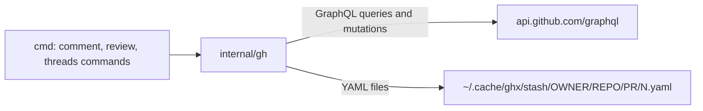
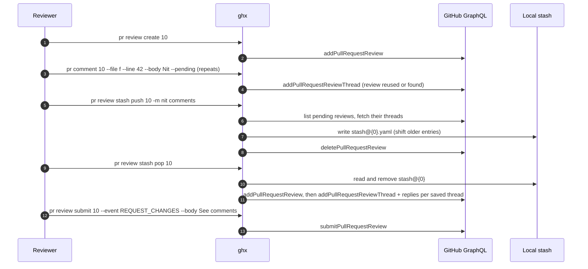
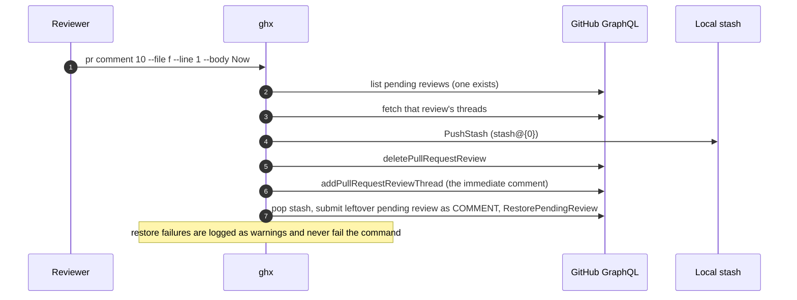

# Specification: Comment operations

## Overview

The feature is two command families in `cmd/` (comment commands and review/thread commands) over one GraphQL mutation client in `internal/gh`.
Read commands (`pr threads`) use the same client's query functions, so the write and read paths for comments live in one package.
Stashes are a purely local concern: pending review threads are serialized to YAML files under the user cache directory, and restoring them replays the same GraphQL mutations an interactive session would use.
The JSON-RPC server exposes none of this; it carries only read methods.

## Architecture

```
cmd/pr_comment.go, pr_comment_edit.go, pr_comment_delete.go   ghx pr comment (post / edit / delete)
cmd/issue_comment.go, issue_comment_edit.go, issue_comment_delete.go   ghx issue comment (post / edit / delete)
cmd/pr_review.go            ghx pr review create | list | submit | discard
cmd/pr_review_stash.go      ghx pr review stash push | pop | list | drop
cmd/pr_threads.go           ghx pr threads (list, --thread / --state / --ids)
cmd/pr_threads_resolve.go   ghx pr threads resolve | unresolve
internal/gh/client.go       GraphQL transport (token resolution, 30s timeout, error mapping)
internal/gh/issue.go        issue reads (node ID, comments)
internal/gh/pr.go           PR thread/review reads plus every comment and review mutation
internal/gh/stash.go        local stash store (YAML files, index shifting)
```



Commands resolve the repository with the global `-R/--repo` flag or the checkout's `origin` remote, resolve the number argument, validate flag combinations with cobra's mutual-exclusion markers plus `RunE` guards, and then call `internal/gh` functions that each embed one GraphQL document as a raw string constant.

## Data Models

### SavedThread (stash and restore unit)

| Field | Type | Constraints | Description |
|---|---|---|---|
| Path | string | required | File path within the PR diff |
| Line | *int | nil for file-level threads | End line of the comment anchor |
| StartLine | *int | nil unless a range | Start line of a multi-line anchor |
| Side | string | LEFT or RIGHT | Diff side |
| Bodies | []string | at least one | First entry is the thread root comment, the rest are replies in order |

### StashEntry (YAML on disk, keys `threads` and `message`)

| Field | Type | Constraints | Description |
|---|---|---|---|
| Threads | []SavedThread | one per file:line anchor | Saved threads of one pending review |
| Message | string | optional, omitted when empty | `--message` description from `stash push` |

One stash entry is one file: `~/.cache/ghx/stash/OWNER/REPO/PRNUMBER/INDEX.yaml` (the cache dir comes from `os.UserCacheDir`), where the index is a dense non-negative integer; `listStashFiles` sorts indices numerically and ignores non-numeric files.

### ReviewThread (GraphQL read, `ghx pr threads`)

| Field | Type | Description |
|---|---|---|
| ID | string | Thread node ID, the argument to resolve, unresolve, and `--reply-thread` |
| Path | string | File the thread anchors to |
| Line, StartLine | *int | Anchor, nil for file-level threads |
| DiffSide | string | LEFT or RIGHT |
| IsResolved, IsOutdated | bool | Rendered as state `resolved`, `outdated`, or `open` |
| Comments | []ReviewComment | Thread conversation |

### ReviewComment and IssueComment (GraphQL reads)

| Field | Type | Description |
|---|---|---|
| ID | string | Node ID used by edit and delete |
| Body | string | Markdown text |
| Author | string | Login |
| CreatedAt | string | Timestamp as returned by GitHub |
| ReviewID | string (ReviewComment only) | Owning review; used to attribute pending threads to a pending review |

### PendingReview

| Field | Type | Description |
|---|---|---|
| ID | string | Review node ID used by submit and discard |
| Author | string | Login; only the current user's reviews are listed |
| CreatedAt | string | Timestamp as returned by GitHub |

## API Contracts

The feature is a CLI; there is no RPC surface for it (the JSON-RPC server registers only `repo.list`, `repo.delete`, `issue.list`, `issue.view`, `pr.list`, `pr.view`, and `pr.threads`, all read-only, so comment and review writes are intentionally absent).
The normative contract is the command surface below plus the GraphQL documents in `internal/gh`.

| Command | Flags | Purpose |
|---|---|---|
| `ghx pr comment <number>` | `-b/--body`, `-F/--body-file`, `--file`, `--line`, `--side`, `--reply-thread`, `--pending`, `--stash=N` | Post a top-level, inline, or file-level comment, reply to a thread, stage in a pending review, or append to a local stash |
| `ghx pr comment edit <comment-id>` | `-b/--body`, `-F/--body-file` | Edit a PR comment, dispatching by node type |
| `ghx pr comment delete <comment-id>` | none | Delete a PR comment, dispatching by node type |
| `ghx issue comment <number>` | `-b/--body`, `-F/--body-file` | Post a top-level issue comment |
| `ghx issue comment edit <comment-id>` | `-b/--body`, `-F/--body-file` | Edit an issue comment |
| `ghx issue comment delete <comment-id>` | none | Delete an issue comment |
| `ghx pr threads <number>` | `--thread`, `--state`, `--ids` | List review threads with comments and optionally comment IDs |
| `ghx pr threads resolve <thread-id>...` | none | Mark threads resolved, continuing past failures |
| `ghx pr threads unresolve <thread-id>...` | none | Reopen threads, continuing past failures |
| `ghx pr review create <number>` | none | Start a pending review |
| `ghx pr review list <number>` | none | List the current user's pending reviews |
| `ghx pr review submit <number>` | `--event`, `-b/--body`, `-F/--body-file`, `--review` | Submit a pending review as COMMENT, APPROVE, or REQUEST_CHANGES |
| `ghx pr review discard <review-id>` | none | Delete a pending review |
| `ghx pr review stash push <number>` | `-m/--message` | Save all pending comments to stash@{0} and delete the pending review |
| `ghx pr review stash pop <number>` | `--stash N` | Restore an entry into a new pending review and remove it |
| `ghx pr review stash list <number>` | none | List stash entries with counts |
| `ghx pr review stash drop <number>` | `--stash N` | Remove an entry without restoring |

Error exits are command failures with a lowercase, fix-naming message; successes print the created node IDs or human-readable confirmations.

### GraphQL documents

Every write is one mutation document in `internal/gh/pr.go` or reached through it:

| GraphQL operation | Used by | Purpose |
|---|---|---|
| `addComment` | `pr comment` (top-level), `issue comment` | Comment on a subject node (issue or PR) |
| `addPullRequestReviewThread` | `pr comment --file`, `RestorePendingReview` | Create a thread (inline, ranged, or file-level via `subjectType` FILE) |
| `addPullRequestReviewThreadReply` | `pr comment --reply-thread`, `RestorePendingReview` | Reply inside a thread |
| `updatePullRequestReviewComment` | `pr comment edit` (inline) | Edit an inline comment |
| `updateIssueComment` | `pr comment edit` (top-level), `issue comment edit` | Edit a top-level comment |
| `deletePullRequestReviewComment` | `pr comment delete` (inline) | Delete an inline comment |
| `deleteIssueComment` | `pr comment delete` (top-level), `issue comment delete` | Delete a top-level comment |
| `resolveReviewThread` / `unresolveReviewThread` | `pr threads resolve` / `unresolve` | Set thread state |
| `addPullRequestReview` | `review create`, `FindOrCreatePendingReview`, `RestorePendingReview` | Create a pending review |
| `submitPullRequestReview` | `review submit`, leftover submit in FR-8 | Submit with event COMMENT, APPROVE, or REQUEST_CHANGES |
| `deletePullRequestReview` | `review discard`, `stash push`, FR-8 auto-stash | Discard a pending review |

Reads used by the feature: `repository { issue { id, comments } }`, `repository { pullRequest { id, reviewThreads, reviews(states: [PENDING]) } }`, `node { __typename }` for type dispatch, and `viewer { login }` to filter pending reviews to the current user.

## Sequences

### Offline draft: pending, stash, pop, submit



### Immediate inline comment while a pending review exists (FR-8)



`stash pop` refuses to run while a pending review exists on the PR, because GitHub allows only one pending review per user.

## Technical Decisions

| Decision | Choice | Rationale |
|---|---|---|
| Transport | GraphQL v4 for every read and write | The comment, review-thread, and pending-review mutations ghx needs either do not exist in REST or would need REST review-comment positioning logic; GraphQL node IDs are stable handles for edit, delete, reply, and resolve |
| Comment edit and delete dispatch | `node { __typename }` probe, then the matching mutation | One command pair handles both inline review comments and top-level issue comments, so the user does not need to know the comment's kind; issue edit and delete skip the probe because they are unambiguous |
| Stash format | One YAML file per entry via `gopkg.in/yaml.v3` | Human-inspectable drafts on disk, trivially serializable `SavedThread` structs, and no database dependency for a feature that must work offline |
| Stash semantics | git-stash style dense indices with push/pop/drop/list | Matches the mental model reviewers already have; new entries land at stash@{0} and older entries shift up |
| Line ranges | `--line START-END` maps to GraphQL `startLine`/`line` with start less than end enforced client-side | Mirrors GitHub's multi-line comment model; the end line is the anchor |
| ID discovery | `pr threads --ids` and `issue view --ids` print node IDs | Node IDs are opaque and long; surfacing them next to the comment text is the cheapest discovery path |
| Submit event validation | Client-side whitelist of COMMENT, APPROVE, REQUEST_CHANGES | Fails fast with a fix-naming message instead of a GraphQL enum error |
| Resolve batching | Attempt every thread, join failures with `errors.Join`, exit non-zero | A typo in one ID must not silently skip the rest of a review sweep |
| Pending-review scope | Filter `reviews(states: [PENDING])` by `viewer { login }` | GitHub returns only the author's pending reviews; the filter keeps the first match deterministic |

## Risks and Unknowns

1. `gh.ClearStash` is exported but not wired to any command; it is dead code from the stash feature (candidate for removal or for a future `stash clear` command).
2. `RestorePendingReview` can partially fail after creating the pending review (a thread may no longer be in the diff after a force-push), leaving a pending review with fewer threads than the stash entry, which is then removed; the error message names the file that failed but the remaining threads are only in the new pending review.
3. List reads cap pagination (`reviewThreads(first: 100)`, `comments(first: 50)` per thread, `reviews(first: 25)`, issue `comments(first: 100)`); larger PRs silently truncate, which can hide threads from `pr threads` and pending threads from `stash push`.
4. `--state` accepts only open, resolved, and all; any other value filters everything out and prints "No review threads found." rather than an error.
5. The FR-8 auto-stash submits a leftover pending review as COMMENT without asking; a reviewer who staged comments intentionally gets them published when they post one immediate comment.
6. Test coverage for the write paths is thin (see tests.md): the stash store, the comment and review mutations, and most command guards have no automated tests.

## Out of Scope

- The JSON-RPC server: it deliberately exposes no comment, review, or stash methods.
- Suggested changes, review-requested state, and any review workflow beyond pending-review staging.
- Editing or deleting review thread state other than resolve and unresolve (no thread deletion).
- Cross-PR or cross-repository stash transfers; a stash entry is bound to one owner, repository, and PR number.
