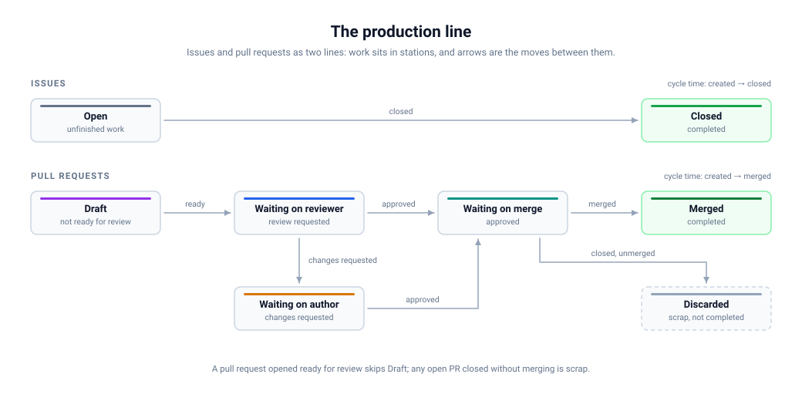

# Process report

`ghx process` generates an HTML report that reads a repository's issues and
pull requests as a production line: items sit in stations, move between them,
and the report answers how much work sits where, how long it takes to flow
through, and whether the queues are growing.

Run `ghx cache` first so the report covers full history; like `stats`, it
serves data from the local cache and only falls back to the GitHub API when
nothing is cached.

[](../assets/process-flow.svg)

## The two lines

- **Issues**: an open issue sits in the *Open* station; closing it moves it to *Closed*.
- **Pull requests**: a PR is *Draft* until it is marked ready for review, then
  *Waiting on reviewer*. An approval moves it to *Waiting on merge*; changes
  requested move it to *Waiting on author*. Merging moves it to *Merged*;
  closing without merging moves it to *Discarded*, which counts as scrap
  rather than as a completion. PRs opened directly as ready for review skip
  the draft station. The review stations come from cached reviews, so a cache
  collected before reviews were persisted shows those PRs in one unsplit
  bucket until you refresh.

Cycle time is measured from creation to the completion station (close for
issues, merge for pull requests). Draft/ready history comes from cached
timeline events, so repositories cached before that data was collected show
their open PRs at the station their current state implies.

## What the report shows

- **Production line**: each station's inventory with the waiting time of the
  items currently there, and the moves observed in the window as arrows.
- **Cumulative flow**: one stacked band per active station per day, with
  cumulative completions on top; a widening band is a queue forming.
- **Bottlenecks**: where completed PR time went (draft, waiting on reviewer,
  waiting on author, waiting on merge, per recorded flips and reviews), and
  each station's queue pressure (arrived, departed, net, and a weekly WIP
  sparkline). PRs merged without any recorded flips or reviews are reported
  as one "no draft/ready history" bucket, since their split is not known. A
  filling queue receives items faster than it passes them on.
- **On the line now**: the aging list of every open issue and open PR, longest
  wait first (the rendered page caps the table; the JSON API lists them all).
- **Cycle time**: median, p90, and mean per line with a histogram.
- **Flow**: Little's law per line (average work in process, throughput, and
  the cycle time the queue depth implies), weekly arrivals versus completions,
  a Monte Carlo forecast of when today's items clear, and where the window's
  arrivals stand now.

## Usage

```bash
ghx cache                                       # populate the cache first
ghx process                                     # current repository, last 90 days
ghx process acme/widget acme/gadget --days 30   # several repositories
ghx process --days 180 -o flow-report.html      # longer window, custom output
```

## Flags

| Flag | Description |
| --- | --- |
| `--days` | Reporting window in days, 1-730 (default `90`) |
| `--output`, `-o` | Output HTML file path (default `process-report.html`) |

Repositories are given as positional `[HOST/]OWNER/REPO` arguments and default
to the current repository (or `--repo`).

## In the web UI

The same report is served by `ghx serve` at `/process`, computed from the
cache only; the Process button in the top bar opens it for the current
repository. The page carries a period form (From and To dates, plus a days shortcut
with Apply) that reloads the report over the chosen range or window while
keeping the requested repositories. When either date is set the report
covers that explicit range (an empty From starts at the first item, an
empty To ends today); with the dates cleared the window field sets a
trailing window; with everything empty the report covers all available
history, which is the default.

The range decides which issues and PRs are considered: the report describes
the line as it stood at the range end. Items opened after the range end are
excluded, items that finished after it count as still-open work in their
pre-finish station, station ages are measured against the range end, and
the aging list shows what was on the line then. The numbers are also available as JSON at
`/api/process`:

```bash
curl -s "http://127.0.0.1:8080/process?repo=github.com/octocat/hello-world&days=30"
curl -s "http://127.0.0.1:8080/api/process?repo=github.com/octocat/hello-world" | jq '.issues.cycleTime'
```

| Parameter | Meaning |
| --- | --- |
| `repo` | `host/owner/repo` to report on; repeat for several repositories, omit for all cached ones |
| `days` | Reporting window in days, 1-730 (default `90`) |

An invalid `days` value answers `400`; a repository that is not cached fails
with `400` on the JSON endpoint and `500` on the HTML page.
